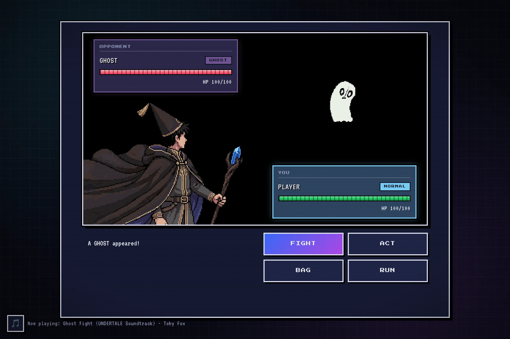

# PortfolioMon

**A portfolio you play.** PortfolioMon is my developer portfolio built as a retro, turn-based battle game. Visitors pick an opponent, name their character, and win (or talk their way out of) fights to unlock each section of my résumé. In a hurry? One click unlocks everything.

**[▶ Play it live](https://creative-portfolio-47717.web.app)** · [About me](#about-the-author)



---

## Why I built it

Most portfolios are a page you scroll past in ten seconds. I wanted one people would remember and actually spend time with. I also used it to practise things a normal brochure site never needs: a state machine, game logic that's easy to test, audio, and keyboard-first navigation.

## Features

- **Battle system:** turn-based fights with HP, speed order, type effectiveness (super effective / not very effective) and status moves like Trick Room.
- **Three different boss fights,** each unlocking one résumé section:
  - a straight fight that unlocks **About Me & Résumé**,
  - a "befriend, don't fight" encounter (ACT → TALK → JOKE) that unlocks **Professional Experience**,
  - a quiz battle that unlocks **Education**.
- **Guided chat:** a scripted chatbot that answers questions about my background and maps free-typed questions to the closest topic by keyword.
- **No fight required:** Skills, Projects and Contact are always open, and a "just browsing?" option unlocks the whole menu at once.
- **Retro presentation:** a typewriter text effect, sound effects, background music with in-game controls, and a type chart.
- **Keyboard and mouse:** the menus work with both.

## Tech stack

| Area | Tools |
| --- | --- |
| UI | React 19, plain CSS |
| Build | Vite |
| Game logic | Plain JavaScript modules (`src/game/`), separate from the UI |
| Quality | ESLint (with `react-hooks`), a Node test script for the battle simulation |
| Hosting | Firebase Hosting (static SPA) |

## How it's built

```
src/
  components/   screens: Start, NameEntry, MainMenu, BossSelect, Battle, Content, Chat
  game/         one module per fight (pure functions that build each turn's steps)
  hooks/        useBattle (the battle state machine), useAudio, useBackgroundMusic, useTypewriter
  data/         all portfolio content, menus, bosses, quiz questions, chat script
```

- **The game logic doesn't depend on React.** Each fight in `src/game/` is a pure function that takes the battle state and returns the sequence of steps to play (text, damage, animations). `useBattle` plays those steps back. That split is why the fights can be tested in plain Node (`sim.test.mjs`) without a browser.
- **The content lives in data files.** Everything on the résumé pages lives in `src/data/content.js`, so I can update my experience without touching any components.

## Run it locally

Requires Node.js 20+.

```bash
git clone https://github.com/shuu-pao/PortfolioMon.git
cd PortfolioMon
npm install
npm run dev        # http://localhost:5173
```

| Command | What it does |
| --- | --- |
| `npm run dev` | Start the dev server |
| `npm run build` | Production build into `dist/` |
| `npm run preview` | Serve the production build locally |
| `npm run lint` | Run ESLint |
| `node --loader ./resolve.mjs sim.test.mjs` | Simulate every boss fight end to end |

Deploy with `firebase deploy` once `npm run build` has produced `dist/`.

## Credits

This is a non-commercial fan project. The music, sound effects and character art belong to their respective owners (including the *Pokémon*, *Persona*, *Undertale* and *Bleach* franchises) and are used only as a tribute.

## About the author

**Paolo Jansen Enrera**, Software Engineering Associate at Accenture and BS Computer Engineering graduate of the University of San Carlos, Cebu. I build web and mobile apps as personal projects.

[LinkedIn](https://www.linkedin.com/in/paolo-jansen-enrera/) · [GitHub](https://github.com/shuu-pao)

## License

The code is under the [MIT License](LICENSE). The third-party assets listed under Credits are not covered by that license.
